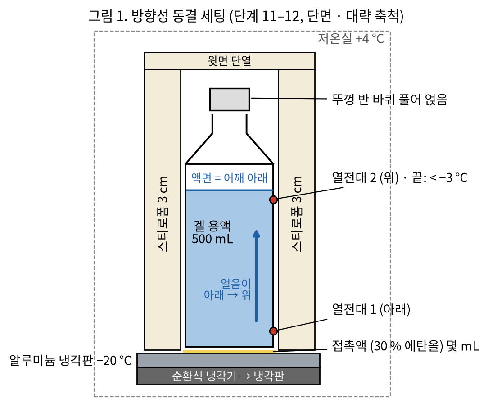
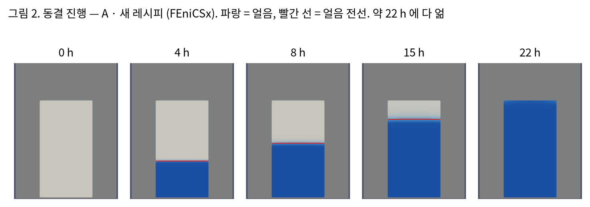
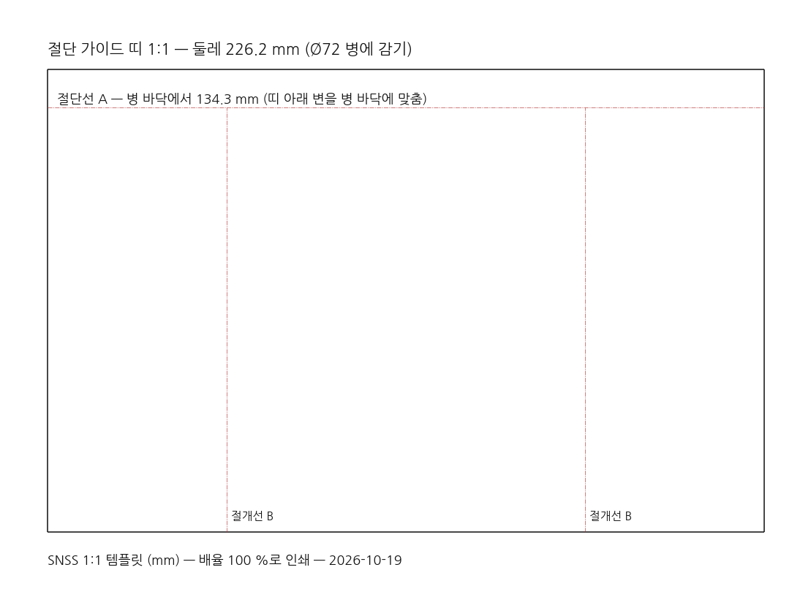
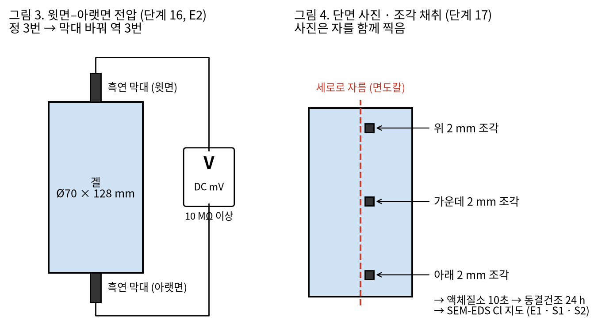

# SNSS 통째 결정 (인공세포형) — 실험대 기록지

500 mL 식염수병 하나 기준 · 전체 약 106 h (4.4 일), 손이 드는 시간 약 5.8 h · 수작업 9단계 / 기계작업 10단계

| 날짜 | 실험자 | 시료 (하나에 ✔) | eLabFTW 실험 번호 |
|---|---|---|---|
| &nbsp; | &nbsp; | ☐ 본 시료 1회 (S4) ☐ 본 시료 3회 ☐ 대조군 A ☐ 대조군 B ☐ 대조군 C | &nbsp; |

- 원본: `RECIPE.md` 3절 · `snss_battery/process.py`. 판정 기준: `EXPERIMENT_PROTOCOL.md`. 동결 · 해동 시간은 FEniCSx 계산값입니다.
- **금속 무함유 원칙:** 금속 도구를 겔에 직접 대지 않습니다. 전압은 흑연 막대로만 잽니다.
- **이번 단계에서는 전기가 나오지 않는 것이 정상입니다.** 윗면–아랫면 전압 예측은 약 2 mV 이고, LED 는 켜지지 않습니다.

---

## 1. 재료표

| ✔ | 재료 | 규격 | 이번에 쓰는 양 (병 1개) | 로트 · 메모 |
|---|---|---|---|---|
| ☐ | 멸균생리식염수 | 0.9 %, 500 mL **나사 마개** 병 | 1병 (병은 그릇으로도 씀) | |
| ☐ | 그래핀 산화물(GO) 분산액 | 4 mg/mL, 판 크기 10 µm 이상 | 62.5 mL (병 안 0.5 mg/mL) + 예비 시험 2.5 mL | |
| ☐ | PVA (폴리비닐알코올) | 분자량 85,000–124,000, 가수분해 99 % 이상 | 15.00 g (병 전체 3 wt%) | |
| ☐ | 증류수 | — | 증발한 만큼 (보통 10–20 mL) | |
| ☐ | 접촉액 | 30 % 에탄올 (−20 °C 에서 얼지 않음) | 몇 mL (전지에 들어가지 않음) | |

**나눠 담는 양**

| 묶음 | 양 |
|---|---|
| PVA 용액 | 병에서 식염수 100 mL 를 덜어 PVA 15 g 을 녹임 (15 wt%) |
| GO 자리 비우기 | 식염수 62.5 mL 를 더 덜어 냄 → 병에 337.5 mL 남음 |
| 최종 | 남은 식염수 337.5 + PVA 용액 100 + GO 62.5 = **500 mL** |

> 대조군 A · C 는 같은 배합이라 한 번에 만들어 나눠 담습니다. 대조군 B 는 **GO 없이** 따로 만듭니다 (GO 대신 식염수 62.5 mL).

## 2. 장비 확인

| ✔ | 장비 | 단계 |
|---|---|---|
| ☐ | 전자저울 0.01 g · 칭량 접시 | 2, 4, 6, 10 |
| ☐ | 핫플레이트 교반기 + 온도 프로브 · 교반 막대 · 알루미늄 호일 | 4–8 |
| ☐ | 비커 250 mL · 1 L, 메스실린더 100 mL, 깔때기, 20 mL 바이알, 피펫 | 3, 7, 8, 10 |
| ☐ | 진공 데시케이터 + 펌프 | 9 |
| ☐ | 순환식 냉각기 + 알루미늄 냉각판 (−20 °C), 저온실 +4 °C | 1, 11–14 |
| ☐ | 스티로폼 3 cm, 열전대 2개 + 기록계 | 11–14 |
| ☐ | 항온수조 25 °C | 13, 14 |
| ☐ | 커터 · 면도칼 · 절단 가이드 띠 (`cad_out/template_1to1.pdf`, **배율 100 %** 인쇄) | 15, 17 |
| ☐ | 흑연 막대 2개 · 멀티미터 (입력 저항 10 MΩ 이상) | 16 |
| ☐ | 실체현미경 (자 함께) · 액체질소 · 동결건조기 · SEM-EDS (공용 장비실 예약) | 17–19 |
| ☐ | 장갑 · 마스크 · 보안경 · 저온 장갑 | 전체 |

## 3. 안전

- GO 가루나 분무는 들이마시지 않습니다 (마스크 · 장갑). 분산액이면 위험이 작습니다.
- 90 °C 핫플레이트에 데지 않게 주의합니다. 병을 자를 때는 겔을 받친 채 자릅니다.
- 액체질소: 보안경 · 저온 장갑, 환기되는 곳, **밀폐 용기에 담지 않음**.
- 금이 간 진공 데시케이터는 쓰지 않습니다.

## 4. 일정

| 날 | 할 일 | 실제 시작 시각 |
|---|---|---|
| 1일 | 오전 1–11 (준비 약 5 h) → 오후 2시쯤 동결 세팅 | |
| 2일 | 12 동결 끝 (약 22 h) → 13 해동 (약 2.4 h) → **S4 1회 시료는 바로 15–17** → 오후 2회차 동결 | |
| 3일 | 2회차 동결 끝 → 해동 → 3회차 동결 세팅 | |
| 4일 | 3회차 동결 끝 → 해동 → 15–17 (꺼내기 · 전압 · 단면 고정) → 18 동결건조 시작 | |
| 5–6일 | 19 SEM-EDS. E3 용 조각은 3일 뒤 같은 방법으로 고정 | |

---

## 5. 공정 — 단계마다 체크

**수작업** = 자리를 지킴 · **기계작업** = 장비가 혼자 함, '넘어가는 조건'만 확인

### ☐ 1. 냉각판 예냉 — 기계작업 · 손 5 분
- 냉각기를 −20 °C 로 켭니다. 판이 식는 30–60분 동안 다음 단계를 진행합니다.
- **넘어가는 조건:** 판 표면 −20 ± 1 °C (동결 세팅 전까지)
- 기록: 켠 시각 ______ 판 온도 ______ °C

### ☐ 2. 계량 — 수작업 · 10 분
- PVA 가루 15.00 g 을 잽니다.
- **조건:** 15.00 ± 0.05 g  · 기록: ______ g

### ☐ 3. 식염수 덜어 내기 — 수작업 · 5 분
- 병에서 식염수 100 mL 를 250 mL 비커에 덜고, 62.5 mL 를 더 덜어 따로 둡니다. 병은 마개를 닫아 둡니다.
- **조건:** 병에 337.5 mL 남음

### ☐ 4. PVA 분산 — 수작업 · 10 분
- 상온에서 300 rpm 으로 저으며 PVA 를 조금씩 뿌립니다. 호일로 덮고 **비커째 무게**를 적습니다.
- **조건:** 덩어리 없이 뿌옇게 퍼짐 · 기록: 비커째 무게 ______ g

### ☐ 5. PVA 용해 — 기계작업 · 약 2 h
- 용액 온도 90 °C, 300 rpm 으로 약 2 h 녹입니다. 30분마다 봅니다.
- **조건:** 투명하고 덩어리 없음 (15 wt%, 꿀처럼 진함)
- 기록: 시작 ______ 끝 ______

### ☐ 6. 증발 보정 · 식히기 — 기계작업 · 약 40 분
- 비커째 무게를 재서 줄어든 만큼 증류수를 보충합니다. 가열을 끄고 저으며 식힙니다.
- **조건:** 무게 복원 · 40 °C 이하 · 기록: 보충한 증류수 ______ g

### ☐ 7. 예비 시험 — GO 응집 — 수작업 · 30 분
- 20 mL 바이알에 식염수 13.5 mL + PVA 용액 4 mL + GO 2.5 mL 를 섞어 30분 둡니다.
- **조건:** 빛에 비춰 고른 갈색이면 진행. **알갱이나 가라앉은 층이 보이면 중단합니다.**
- 결과: ☐ 고른 갈색 → 진행  ☐ 응집 → 중단 (메모: ____________________)

### ☐ 8. 비커에서 섞기 — 기계작업 · 약 35 분
- 병의 남은 식염수 337.5 mL 를 1 L 비커에 붓고, 300 rpm 으로 저으며 **PVA 용액 → GO 62.5 mL** 순서로 천천히 넣습니다. 30분 젓습니다.
- **조건:** 줄무늬 없이 고른 갈색

### ☐ 9. 기포 빼기 — 기계작업 · 약 20 분
- 15분 감압합니다. 거품이 끓어오르면 잠깐 진공을 풉니다.
- **조건:** 표면에 기포 없음

### ☐ 10. 병에 다시 담기 — 수작업 · 10 분
- 벽을 타고 흐르게 천천히 병에 붓습니다. **뚜껑은 반 바퀴 풀어 얹습니다** (얼면 부피가 9 % 늘어남).
- **조건:** 500 mL · 액면이 어깨 아래 · 기록: 담은 무게 ______ g

### ☐ 11. 동결 세팅 — 수작업 · 15 분

- 병 바닥이 평평한지 봅니다. 냉각판에 접촉액을 몇 mL 떨어뜨리고 병을 세웁니다.
- 옆면 · 윗면을 스티로폼 3 cm 로 감싸고, 병 벽 아래 · 위에 열전대를 붙입니다.
- **조건:** 바닥 열전대가 내려가기 시작 · 기록: 세팅 시각 ______

### ☐ 12. 방향성 동결 — 기계작업 · 약 22 h

- **손대지 않습니다.** 얼음이 아래에서 위로 자라며 세포가 생깁니다. 저온실 문을 자주 열지 않습니다.
- **조건:** 위쪽 열전대 < −3 °C (판 접촉이 나쁘면 더 걸림) → 아래 6절 온도 기록표에 적기

### ☐ 13. 해동 — 기계작업 · 약 2.4 h
- 병을 어깨까지 25 °C 항온수조에 담급니다.
- **조건:** 병을 눌러 단단한 심이 없음
- **S4 용 1회 시료는 여기서 바로 15–17 로 갑니다.**

### ☐ 14. 재동결 · 해동 × 2 — 기계작업 · 약 49 h
- 11과 같은 방법으로 다시 방향성 동결 → 수조 해동을 2번 합니다. PVA 골격이 단단해집니다.
- **조건:** 회차마다 열전대 기록 (6절)

### ☐ 15. 병 절단 · 꺼내기 — 수작업 · 15 분

- 가이드 띠 아래 변을 병 바닥에 맞춰 감고, 절단선 A (바닥에서 134.3 mm) 와 절개선 B 2줄을 따라 자릅니다. 겔을 받친 채 꺼냅니다.
- **조건:** **10분 안에** 16 측정 시작 (표면이 마르면 저항이 커짐) · 기록: 꺼낸 시각 ______

### ☐ 16. 윗면–아랫면 전압 (E2) — 수작업 · 15 분

- 윗면 · 아랫면에 흑연 막대를 **같은 힘으로** 대고 DC mV 를 잽니다. 정 3번, 막대를 바꿔 역 3번. → 6절 표에 적기
- 수십 mV 이상이 나오면 먼저 접촉 전위 · 오염을 의심합니다 (8절).

### ☐ 17. 단면 채취 · 급속 고정 — 수작업 · 30 분
- 세로로 잘라 단면 사진을 찍습니다 (자 함께). 위 · 가운데 · 아래에서 2 mm 조각을 떼어 **액체질소에 10초** 담급니다.
- **조건:** S1–S3 사진 · 조각 3개 고정 · 기록: 사진 파일 이름 ____________________

### ☐ 18. 동결건조 — 기계작업 · 약 24 h
- 고정한 조각을 얼린 채로 말립니다.
- **조건:** 무게 변화 없음 · 기록: 시작 ______ 끝 ______

### ☐ 19. 단면 분석 — SEM-EDS — 기계작업 · 약 2 h
- Cl 지도로 벽 근처와 칸 안의 소금 신호를 비교하고, 칸 폭을 잽니다.
- **조건:** E1 · S1 · S2 기록 (6절)

---

## 6. 측정 기록

**동결 온도 기록 (열전대)**

| 회차 | 세팅 시각 | 위쪽 < −3 °C 된 시각 | 걸린 시간 (예측 22.3 h) | 해동 끝 시각 (예측 +2.4 h) |
|---|---|---|---|---|
| 1 | | | | |
| 2 | | | | |
| 3 | | | | |

**E2 윗면–아랫면 전압 (mV)** — 판정: \|V\| < 50 mV, 정 · 역 부호만 반대 (예측 약 2 mV)

| 시료 | 정 1 | 정 2 | 정 3 | 역 1 | 역 2 | 역 3 | 정 평균 | 역 평균 |
|---|---|---|---|---|---|---|---|---|
| 본 시료 1회 | | | | | | | | |
| 본 시료 3회 | | | | | | | | |
| 대조군 A | | | | | | | | |
| 대조군 B | | | | | | | | |
| 대조군 C | | | | | | | | |

**단면 · SEM-EDS**

| 시료 | 위치 | 칸 폭 (µm) S1 | 닫힌 칸 보임? S1 | Cl 신호 벽 / 칸 비 E1 | 메모 |
|---|---|---|---|---|---|
| 본 시료 1회 | 위 | | ☐ 예 ☐ 아니오 | | |
| | 가운데 | | ☐ 예 ☐ 아니오 | | |
| | 아래 | | ☐ 예 ☐ 아니오 | | |
| 본 시료 3회 | 위 | | ☐ 예 ☐ 아니오 | | |
| | 가운데 | | ☐ 예 ☐ 아니오 | | |
| | 아래 | | ☐ 예 ☐ 아니오 | | |
| 대조군 C | 가운데 | | ☐ 예 ☐ 아니오 | | |

- E3 (3일 뒤 · 4 °C 밀봉 보관한 3회 시료): 벽 / 칸 비 ______ (처음 값의 절반 이상이면 충족)
- 측정값은 웹 뷰어 **실험 기록** 탭과 eLabFTW 실험에도 옮겨 적습니다.

## 7. 판정 기준 (측정 전에 정해 둔 것 — 바꾸지 않음)

| 가설 | 충족 기준 | 모델 예측 | 결과 |
|---|---|---|---|
| **E1** 빈 세포에 에너지 | 벽 / 칸 Cl 비 ≥ 10배, 대조군 C 는 2배 미만 | 수백 배 | ☐ 충족 ☐ 불충족 |
| **E2** 위아래 대칭 | \|V\| < 50 mV, 정 · 역 부호만 반대 | 약 2 mV | ☐ 충족 ☐ 불충족 |
| **E3** 에너지 유지 | 3일 뒤에도 E1 비가 절반 이상 | 서서히 줄어듦 | ☐ 충족 ☐ 불충족 |
| **S1** 세포와 막 | 닫힌 칸, 칸 폭 50–500 µm | 140–280 µm | ☐ 충족 ☐ 불충족 |
| **S2** 아래 → 위 성장 | 아래쪽 칸이 위쪽보다 작음 | 아래 작고 위 큼 | ☐ 충족 ☐ 불충족 |
| **S3** 프랙탈 연속성 | 벽 프랙탈 차원 1.1–1.7 | 약 1.25–1.4 | ☐ 충족 ☐ 불충족 |
| **S4** 동결이 막을 안 깸 | 1회 → 3회 사이 E1 비가 절반 아래로 안 떨어짐 | 미지수 | ☐ 충족 ☐ 불충족 |

## 8. 흔한 착오 (가짜 양성)

- **금속 프로브:** 금속이 식염수에 닿으면 수십–수백 mV 가 저절로 생깁니다. 같은 재질 흑연 막대만 쓰고, 대조군도 함께 잽니다.
- **누르는 힘 · 접촉 면적:** 바뀌면 값이 흔들립니다. 같은 힘으로 3번 재서 평균을 냅니다.
- **표면 건조:** 꺼낸 뒤 10분 안에 잽니다.
- **멀티미터 입력 저항:** 10 MΩ 미만이면 재는 동안 결정이 방전됩니다.

## 9. 대조군

| 시료 | 만드는 법 | 보려는 것 |
|---|---|---|
| **A** 방향 없이 빨리 얼림 | 같은 배합 병을 −20 °C 냉동실에 그냥 (냉각판 · 단열 없음), 해동 횟수 같게 | 세포가 작고 고름 · 위아래 차이 없음 |
| **B** 식염수 + PVA 만 | GO 없이 같은 방향성 동결 | 막이 없으면 벽 / 칸 Cl 대비가 약함 |
| **C** 얼리지 않음 | 같은 배합을 상온에 | 세포 · 막이 생기지 않음 |

그림 1 · 3 · 4 와 그림 2 는 report/make_figs.py 가 만듭니다 (그림 2 는 ./tools.sh fem-movie 결과). 그림 5 는 cad_out 의 1:1 템플릿입니다.

